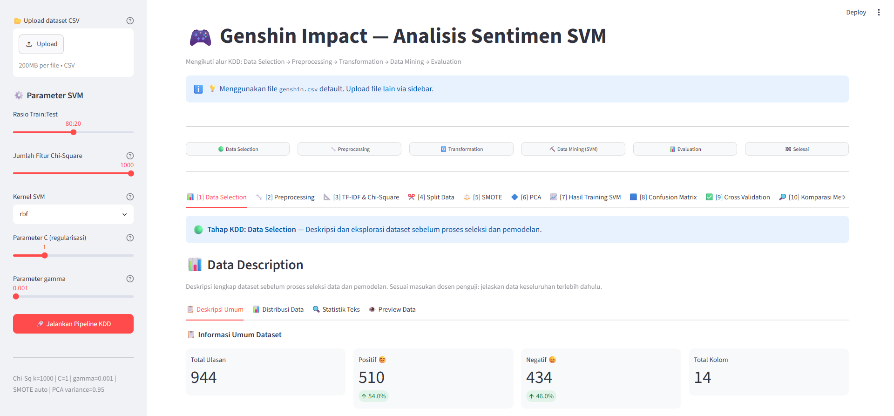
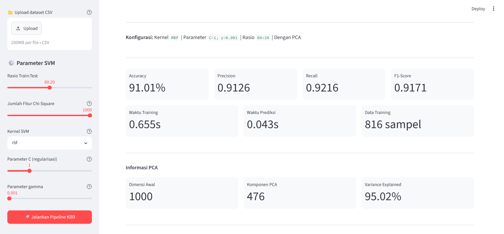

# 🎮 Genshin Impact — Analisis Sentimen Ulasan dengan PCA & SVM

Aplikasi web interaktif (Streamlit) untuk menganalisis sentimen ulasan game **Genshin Impact** menggunakan **Support Vector Machine (SVM)** dan **Principal Component Analysis (PCA)**. Seluruh alur pengerjaan mengikuti tahapan **KDD (Knowledge Discovery in Databases)**, dari seleksi data sampai prediksi sentimen ulasan baru.

Proyek ini merupakan bagian dari skripsi S1 Teknik Informatika, Universitas Negeri Surabaya (UNESA).

---

## 📸 Tampilan Aplikasi

**Dashboard utama — Data Selection**



**Hasil analisis — SVM kernel RBF dengan PCA (rasio 80:20)**



---

## ✨ Fitur Utama

- Alur KDD lengkap dalam **15 tab**: Data Selection → Preprocessing → Transformation → Data Mining → Evaluation → Prediksi.
- Parameter model bisa diatur langsung dari sidebar: rasio train:test, jumlah fitur Chi-Square, kernel SVM, `C`, `gamma`, dan `degree` (khusus kernel poly).
- Perbandingan **dengan vs tanpa PCA** dan **dengan vs tanpa SMOTE** pada semua kernel dan rasio split.
- Evaluasi lengkap: confusion matrix, akurasi, presisi, recall, F1-score, waktu training/prediksi, dan 5-Fold Cross Validation.
- Word Cloud per kategori sentimen.
- Prediksi sentimen ulasan baru secara langsung (model dengan atau tanpa PCA).
- Bisa memakai dataset sendiri lewat upload CSV.

---

## 🔄 Alur Pipeline

| Tahap KDD | Proses |
|---|---|
| **Data Selection** | Deskripsi, distribusi kelas, statistik teks, dan preview data |
| **Preprocessing** | Case folding → normalisasi singkatan → cleaning (URL, angka, emoji, tanda baca) → tokenizing → stopword removal → lemmatization (NLTK WordNet) |
| **Transformation** | Label Encoding → TF-IDF (maks. 5.000 fitur) → Seleksi fitur Chi-Square → Split data (stratified, `random_state=42`) → SMOTE pada data training → StandardScaler → PCA (variance 95%) |
| **Data Mining** | Training SVM (kernel `rbf`, `linear`, `poly`, `sigmoid`) |
| **Evaluation** | Confusion matrix, Cross Validation, komparasi metodologi, PCA vs tanpa PCA, SMOTE vs tanpa SMOTE |
| **Selesai** | Prediksi sentimen ulasan baru |

---

## 📊 Contoh Hasil

Konfigurasi: kernel **RBF**, `C=1`, `gamma=0.001`, rasio **80:20**, Chi-Square **k=1000**, dengan **PCA**.

| Metrik | Nilai |
|---|---|
| Accuracy | **91.01%** |
| Precision | 0.9126 |
| Recall | 0.9216 |
| F1-Score | 0.9171 |
| Waktu training | 0.655 s |
| Waktu prediksi | 0.043 s |
| Data training (setelah SMOTE) | 816 sampel |

**Informasi PCA:** dimensi awal 1000 → **476 komponen**, dengan variance explained **95.02%**.

**Dataset (`genshin.csv`):** 944 ulasan, 14 kolom — 510 positif (54.0%) dan 434 negatif (46.0%).

> Nilai di atas adalah hasil pada konfigurasi default di screenshot. Hasil dapat berbeda jika parameter atau dataset diubah.

---

## 🗂️ Struktur Proyek

```
Genshin_Sentyment/
├── app.py                  # Entry point Streamlit (sidebar, pipeline, 15 tab)
├── genshin.csv             # Dataset default
├── requirements.txt
├── models/
│   └── pipeline.py         # TF-IDF, Chi-Square, SMOTE, PCA, training & evaluasi SVM
├── utils/
│   ├── data_loader.py      # Load & validasi CSV
│   └── preprocessing.py    # Fungsi preprocessing teks
└── tabs/                   # Satu file per tab
    ├── tab_overview.py         ├── tab_confusion.py
    ├── tab_pipeline.py         ├── tab_validation.py
    ├── tab_tfidf_chi2.py       ├── tab_komparasi.py
    ├── tab_split.py            ├── tab_matriks_lengkap.py
    ├── tab_smote.py            ├── tab_pca_compare.py
    ├── tab_pca.py              ├── tab_smote_compare.py
    ├── tab_evaluasi.py         ├── tab_wordcloud.py
    └── tab_prediksi.py
```

---

## 🚀 Cara Menjalankan

**Prasyarat:** Python 3.10 atau lebih baru.

```bash
# 1. Clone repository
git clone <url-repository-anda>
cd Genshin_Sentyment

# 2. (Opsional) Buat virtual environment
python -m venv venv
source venv/bin/activate        # Windows: venv\Scripts\activate

# 3. Install dependensi
pip install -r requirements.txt

# 4. Jalankan aplikasi
streamlit run app.py
```

Aplikasi terbuka di `http://localhost:8501`. Resource NLTK (`punkt_tab`, `stopwords`, `wordnet`) diunduh otomatis saat pertama kali dijalankan, jadi butuh koneksi internet di awal.

**Cara pakai singkat:**
1. Biarkan dataset default, atau upload CSV sendiri lewat sidebar.
2. Atur parameter SVM di sidebar.
3. Klik **🚀 Jalankan Pipeline KDD**.
4. Telusuri tab 1 sampai 15 untuk melihat setiap tahapan dan hasilnya.

---

## 📁 Format Dataset

CSV yang diupload **wajib** memiliki dua kolom:

| Kolom | Keterangan |
|---|---|
| `content` | Teks ulasan (bahasa Inggris) |
| `sentiment` | Label sentimen: `POSITIVE` / `NEGATIVE` |

Kolom lain di `genshin.csv` (`reviewId`, `userName`, `score`, `at`, dll.) tidak dipakai dalam pemodelan.

---

## 🛠️ Teknologi

Python · Streamlit · scikit-learn · imbalanced-learn · NLTK · pandas · NumPy · Matplotlib · Seaborn · WordCloud · python-docx

---

## 👤 Penulis

**Gemma Dwi Prasetya**
S1 Teknik Informatika, Fakultas Teknik, Universitas Negeri Surabaya (UNESA)
